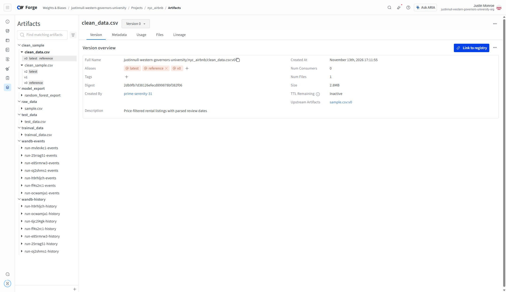
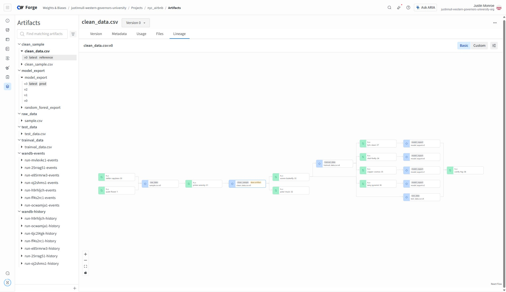

# NYC rental-price machine learning pipeline

This project uses MLflow, Hydra, scikit-learn, and W&B to clean rental listings, validate data, compare random forests, and evaluate a selected model on held-out data.

- [GitHub repository](https://github.com/justinmon/Project-Build-an-ML-Pipeline-Starter)
- [Public W&B project](https://forge.coreweave.com/wandb/justinnull-western-governors-university/nyc_airbnb)
- [Reviewer corrections](RESUBMISSION_CORRECTIONS.md)

## Reviewer-requested artifact names

The current code follows the reviewer’s exact naming requirements:

| Purpose | Collection | Type / alias |
| --- | --- | --- |
| Raw sample | `sample.csv` | `raw_data` |
| Cleaned data | `clean_data.csv` | `clean_sample`; fixed baseline alias `reference` |
| Training and validation | `trainval_data.csv` | `trainval_data` |
| Held-out test | `test_data.csv` | `test_data` |
| MLflow model package | `model_export` | `model_export`; selected model alias `prod` |

The cleaner saves and uploads a file named `clean_data.csv`. Data checking and splitting consume `clean_data.csv:latest`; drift checking uses `clean_data.csv:reference`. Training outputs `model_export`; the explicit held-out component consumes `model_export:prod`. The geographic filter retains longitude [-74.25, -73.50] and latitude [40.5, 41.2], in addition to the configured price limits.

## Setup

Use a Linux environment with Conda/Miniforge:

```bash
git clone https://github.com/justinmon/Project-Build-an-ML-Pipeline-Starter.git
cd Project-Build-an-ML-Pipeline-Starter
conda env create -f environment.yml
conda activate nyc_airbnb_dev
export WANDB_BASE_URL=https://api.forge.coreweave.com
wandb login --verify
```

The environment includes Git for remote MLflow release execution. Development uses W&B 0.31.0 and component environments use W&B 0.24.0, with the same Forge endpoint. If Conda is installed in a nonstandard location, set `MLFLOW_CONDA_HOME` to that installation. API keys belong outside the repository.

## Pipeline and model comparison

For a new project, initialize the original reference dataset before running the drift check:

```bash
mlflow run . -P steps=download,basic_cleaning
# In your own W&B project, mark the original clean_data.csv version as reference.
mlflow run . -P steps=data_check,data_split
mlflow run . -P steps=train_random_forest \
  -P hydra_options="modeling.random_forest.max_depth=10,50 modeling.random_forest.n_estimators=100,200 -m"
# Select the lowest validation MAE and apply prod to that model_export version.
mlflow run . -P steps=test_regression_model
```

After the reference exists, `mlflow run .` runs the complete default pipeline. Held-out evaluation is intentionally excluded from default training. Price limits, split sizes, seed, stratification, and forest parameters come from `config.yaml`. Both split stages use seed 42 and borough stratification. The four comparisons vary depth (10/50) and trees (100/200). Select on validation MAE before running the held-out test.

## Resubmission validation

All six data checks passed on the renamed baseline. All four new Hydra jobs finished using the same `trainval_data.csv:v4`. The clean baseline has 19,001 rows: 15,200 train/validation and 3,801 held-out test rows, with zero overlapping IDs. The inner split has 12,160 training and 3,040 validation rows.

| Depth | Trees | Model export | Validation MAE ($/night) | Validation R2 | W&B run |
| ---: | ---: | --- | ---: | ---: | --- |
| 10 | 100 | `model_export:v0` | 34.431949 | 0.545613 | `sifxo00k` |
| 10 | 200 | `model_export:v1` | 34.404576 | 0.546276 | `o8ip6sry` |
| 50 | 100 | `model_export:v2` | 34.196322 | 0.550076 | `qcqtfg92` |
| 50 | 200 | **`model_export:v3`** | **34.184256** | **0.550616** | `i7ayn7af` |

`model_export:v3` received `prod` based on the lowest validation MAE. The subsequent [held-out evaluation](https://forge.coreweave.com/wandb/justinnull-western-governors-university/nyc_airbnb/runs/p7llvwgm) finished using this exact model and `test_data.csv:v4`: test MAE **$33.846924/night**, R2 **0.561929**. Test MAE is about 0.99% lower than validation, indicating comparable performance on this split. Held-out scores were not used to retune or select the model.

The original-sample baseline `clean_data.csv:v0` retains `reference`. [Machine-readable results](RESUBMISSION_RESULTS.json) include the new run IDs, artifact IDs, manifests, row counts, overlap check, evaluation, and release verification. [MODEL_EVALUATION.md](MODEL_EVALUATION.md) records the comparison.

### Corrected release 1.0.4

The exact published [release 1.0.4](https://github.com/justinmon/Project-Build-an-ML-Pipeline-Starter/releases/tag/1.0.4), commit `4192b013f8a2ff31fc64619d0f51f4f2d1e3df3c`, was run remotely with:

```bash
mlflow run https://github.com/justinmon/Project-Build-an-ML-Pipeline-Starter.git \
  -v 1.0.4 -P hydra_options="etl.sample='sample2.csv'"
```

It finished successfully with exit status 0 and all six data checks passing. The new sample's cleaning retained 46,427 listings as `clean_data.csv:v1`; splitting produced `trainval_data.csv:v5`; training produced **`model_export:v4`**, [run d3qrlnnt](https://forge.coreweave.com/wandb/justinnull-western-governors-university/nyc_airbnb/runs/d3qrlnnt), with validation MAE **$32.427103/night** and R2 **0.578117**. These are validation metrics for the updated sample, not a repeated held-out test or a basis for changing the original cohort's selection.

The audit confirmed that `reference` remains on `clean_data.csv:v0` and `prod` remains on the original-sample validation winner `model_export:v3`. See [release verification](RELEASE_VALIDATION.json).

## Evidence from the submitted account

These files are new screenshots from `justinnull-western-governors-university / nyc_airbnb`, with the account breadcrumb visible:

- [Reference alias evidence](images/wandb-tag-data-test.png): the new `clean_data.csv:v0` baseline and its `reference` alias.
- [Pipeline graph evidence](images/wandb-pipeline-graph.png): raw data, cleaning, data checks, splitting, four new models, and held-out evaluation. [Selected model evidence](images/wandb-prod-model.png) shows `model_export:v3` and `prod`.

Click either screenshot to inspect it at full resolution.





The starter animation `images/wandb_select_best.gif` is a course example, not evidence of this account’s work. The executed EDA notebook at `src/eda/eda.ipynb` contains seven executed code cells and zero errors.

## Earlier release exercise

The earlier trial history is preserved. Published baseline 1.0.2 failed `test_proper_boundaries` on exactly one out-of-bounds listing in `sample2.csv`, with five other checks passing. Corrected release 1.0.3 passed all six checks and trained a new model. Those releases used the old collection names; the resubmission update 1.0.4 uses the reviewer-required names above. See the GitHub releases for the immutable earlier code and results.

## Future improvements

Compare other regressors, improve text features, inspect neighborhood-level errors, and monitor drift and model performance over time.

Based on the Udacity WGU starter project. The original license is retained.
